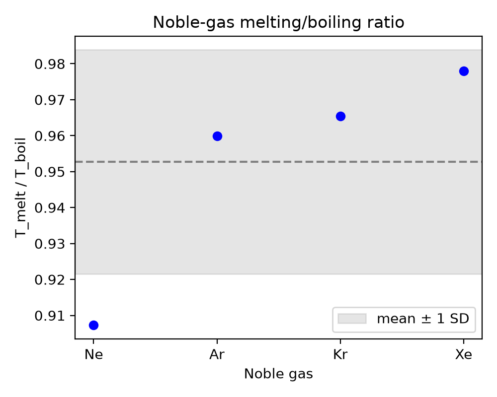

# Part 2: Noble Gas Ratio and Data Cleaning (Problem 9)

PH1050 Final Project: Atoms and the periodic table

## Overview

Lennard-Jones theory predicts that all noble gases follow the same curve, with ε setting only the temperature scale, so T_melt/T_boil should be nearly the same for every noble gas. This part tests that on real data, finds the outlier with a 95% prediction interval, and cleans the element table.

## Data Source

- `ElementData.csv`: <name and link of the source>
- Noble gas melting and boiling points come from the same table. Helium has no melting point at 1 atm (NaN), so it is left out of the ratio.

## Dependencies

Python 3.<your version> or later.

```bash
pip install -r requirements.txt
```

## How to Run

From the repository root:

```bash
python clean_elements.py
python part2_stats.py
```

- `clean_elements.py` keeps only elements that have all of: atomic number, atomic mass, period, group, electronegativity, melting point and boiling point. It prints the counts and saves `elements_clean.csv` for Part 3.
- `part2_stats.py` computes T_melt/T_boil for Ne, Ar, Kr and Xe, prints the mean and standard deviation, builds a 95% prediction interval from Ar, Kr and Xe, and tests whether Ne falls outside it. It saves `noble_gas_ratio.png`.

## Data Cleaning

- Total elements: 118
- Elements with all properties: <number>
- Elements dropped: <number>, because of missing values in one or more of the properties above
- Non-numeric entries are converted to NaN, and rows with any NaN in the used properties are dropped.

## Results

- Mean T_melt/T_boil for Ne to Xe: about 0.953, standard deviation about 0.031
- Ne (about 0.907) is the only point outside mean ± 1 SD, and it lies outside the 95% prediction interval built from Ar, Kr and Xe, so it is the outlier.
- Likely reason: Ne is light, so quantum zero-point motion matters, which the classical Lennard-Jones model does not include.



## Files

- `ElementData.csv`: input data
- `clean_elements.py`: data cleaning
- `part2_stats.py`: ratio, prediction interval and plot
- `elements_clean.csv`: cleaned table (output)
- `noble_gas_ratio.png`: plot (output)
- `requirements.txt`: dependencies

## Who Did What

- Vignesh: Part 2, task 1 (noble gas ratio, prediction interval, outlier analysis, plot); README and repository documentation; report sections for his part
- Lohit: Part 2, task 2 (element table cleaning); presentation slides; report sections for his part
- Both: report written jointly, each member writing their own sections
